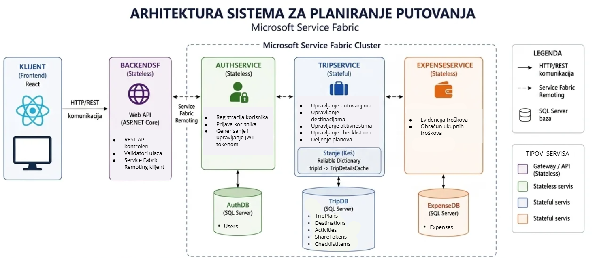
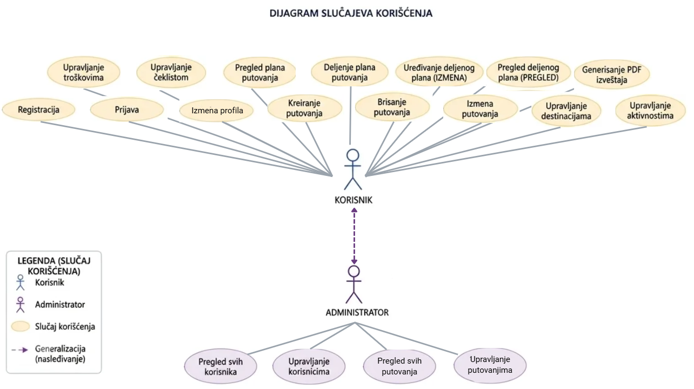

# 🌍 Aventura

Web aplikacija za planiranje putovanja razvijena u okviru predmeta **Primena veb programiranja u infrastrukturnim sistemima**.

Aplikacija omogućava korisnicima da na jednom mestu organizuju sve važne informacije vezane za putovanje, uključujući destinacije, aktivnosti, troškove, budžet i checklistu za pripremu putovanja.

---

# Tehnologije

## Frontend

* React
* TypeScript
* Vite
* Tailwind CSS

## Backend

* ASP.NET Core
* Entity Framework Core
* Microsoft SQL Server
* Microsoft Service Fabric

## Autentifikacija

* JWT Token Authentication
* Password Hashing

---

# Sistemska arhitektura



Sistem je implementiran korišćenjem mikroservisne arhitekture i sastoji se od sledećih servisa:

### AuthService

Servis zadužen za:

* registraciju korisnika
* prijavu korisnika
* autentifikaciju
* upravljanje korisničkim nalozima
* generisanje JWT tokena

### TripService

Servis zadužen za:

* upravljanje planovima putovanja
* upravljanje destinacijama
* upravljanje aktivnostima
* upravljanje checklistom
* deljenje planova putovanja

### ExpenseService

Servis zadužen za:

* upravljanje troškovima
* obračun ukupnih troškova

---

# Use Case dijagram



Sistem podržava sledeće aktere:

## Gost

* Registracija
* Prijava

## Korisnik

* Izmena profila
* Upravljanje planovima putovanja
* Upravljanje destinacijama
* Upravljanje aktivnostima
* Upravljanje troškovima
* Upravljanje checklistom
* Pregled plana putovanja
* Deljenje plana putovanja

## Administrator

* Pregled korisnika
* Upravljanje korisničkim nalozima
* Pregled svih planova putovanja
* Upravljanje putovanjima u sistemu

---

# Funkcionalnosti

## Upravljanje planom putovanja

* Kreiranje plana putovanja
* Pregled planova putovanja
* Izmena plana putovanja
* Brisanje plana putovanja

## Upravljanje destinacijama

* Dodavanje destinacija
* Pregled destinacija
* Izmena destinacija
* Brisanje destinacija

## Organizacija aktivnosti

* Dodavanje aktivnosti
* Pregled aktivnosti
* Izmena aktivnosti
* Brisanje aktivnosti
* Organizacija aktivnosti po datumima

## Evidencija troškova i budžeta

* Dodavanje troškova
* Kategorizacija troškova
* Praćenje ukupnih troškova
* Praćenje preostalog budžeta

## Checklist

* Dodavanje stavki
* Označavanje završenih stavki
* Brisanje stavki

## Deljenje plana putovanja

* Generisanje QR koda
* VIEW pristup
* EDIT pristup

---

# Pokretanje projekta

## Preduslovi

Potrebno je instalirati:

* .NET 8 SDK
* SQL Server
* Node.js
* npm
* Service Fabric SDK

---
## Podešavanje backend servisa (Konfiguracija)

Pre pokretanja aplikacije, potrebno je kreirati lokalne konfiguracione fajlove za svaki mikroservis na osnovu priloženih šablona (`appsettings.Example.json`).

Za svaki servis u sistemu (`AuthService`, `TripService`, `ExpenseService`, `BackendSF`):

1. U korenskom direktorijumu servisa napravi kopiju fajla `appsettings.Example.json` i preimenuj ga u `appsettings.json`.
2. Popuni potrebne parametre pravim lokalnim vrednostima (konekcija ka bazi, JWT tajni ključ, Cloudinary kredencijali).

---

#### Primer izgleda konfiguracije (`appsettings.Example.json`):

```json
{
  "AllowedHosts": "*",
  "ConnectionStrings": {
    "AuthDatabase": "Server=localhost\\SQLEXPRESS;Database=AuthServiceDb;User Id=YOUR_USER;Password=YOUR_PASSWORD;TrustServerCertificate=True;"
  },
  "JwtSettings": {
    "SecretKey": "YOUR_SUPER_SECRET_KEY_HERE_MIN_32_CHARS",
    "Issuer": "Aventura",
    "Audience": "AventuraUsers",
    "ExpiryMinutes": 60
  },
  "Cloudinary": {
    "CloudName": "YOUR_CLOUD_NAME",
    "ApiKey": "YOUR_API_KEY",
    "ApiSecret": "YOUR_API_SECRET"
  }
}

Nakon podešavanja pokrenuti migracije za svaki servis.

## Migracije 

Za svaki servis potrebno je pokrenuti migracije.

### AuthService

```powershell
Update-Database
```

### TripService

```powershell
Update-Database
```

### ExpenseService

```powershell
Update-Database
```

---

## Podešavanje frontenda

Pozicionirati se u direktorijum frontend aplikacije:

```bash
cd AventuraFrontend
```

Instalirati zavisnosti:

```bash
npm install
```

Kreirati `.env` fajl u korenu frontend projekta:

```env
VITE_API_URL=https://localhost:5000
```

URL treba prilagoditi adresi backend sistema.

---

## Pokretanje aplikacije

Pokrenuti Service Fabric aplikaciju iz Visual Studio okruženja.

Pokrenuti frontend:

```bash
npm run dev
```

Nakon pokretanja aplikacija će biti dostupna na:

```text
http://localhost:5173
```

---
